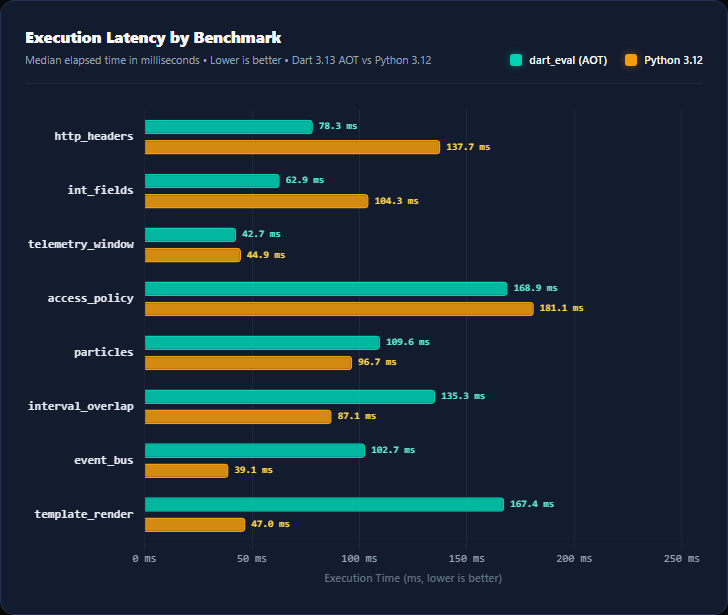

[](https://github.com/ethanblake4/dart_eval/actions/workflows/dart.yml)
[](https://opensource.org/licenses/BSD-3-Clause)
[](https://ethanblake.xyz/evalpad)
[](https://github.com/ethanblake4/dart_eval)
[](https://github.com/sponsors/ethanblake4)

`dart_eval` is an extensible bytecode compiler and interpreter for the Dart language, 
written in Dart, enabling dynamic execution and codepush for Flutter and Dart AOT.

| dart_eval    | [](https://pub.dev/packages/dart_eval)          |
| ------------ | ------------------------------------------------------------------------------------------------------------------------------------ |
| flutter_eval | [](https://pub.dev/packages/flutter_eval) |
| eval_annotation | [](https://pub.dev/packages/eval_annotation) |

The primary aspect of `dart_eval`'s goal is to be interoperable with real 
Dart code. The automated [interop and binding](#interop-and-binding) generation system allows
classes created in 'real Dart' to be used inside the interpreter, and classes
created in the interpreter to be used outside it.

dart_eval's compiler is powered under the hood by the Dart 
[analyzer](https://pub.dev/packages/analyzer) for parsing with a custom compiler and
interpreter that achieves a 100% pass rate on the Dart language test suite and compatibility
with most Pub packages.

However, a few edge-case semantics ([language feature support table](#language-feature-support-table))
and standard library APIs may not have full support.

If you use this project, please consider a small donation on [GitHub Sponsors](https://github.com/sponsors/ethanblake4) to help support its development.

## Usage

> **Note**: See the README for [flutter_eval](https://pub.dev/packages/flutter_eval) for
information on setting up Flutter code push.

A basic usage example of the `eval` method, which is a simple shorthand to
execute Dart code at runtime:

```dart
import 'package:dart_eval/dart_eval.dart';

void main() {
  print(eval('2 + 2')); // -> 4
  
  final program = r'''
      class Cat {
        Cat(this.name);
        final String name;
        String speak() => "I'm $name!";
      }
      String main() {
        final cat = Cat('Fluffy');
        return cat.speak();
      }
  ''';
  
  print(eval(program, function: 'main')); // prints 'I'm Fluffy!'
}
```

## Passing arguments
Pass ordinary Dart values in an `arguments` map keyed by parameter names.
This works for positional and named parameters:

```dart
final program = '''
  int main(int count, String str) {
    return count + str.length;
  }
''';

print(eval(program, function: 'main', arguments: {'count': 1, 'str': 'Hi!'})); // -> 4
```

Omit optional parameters to use their defaults. An explicitly supplied `null`
means null, and is rejected for a non-nullable parameter. Missing required names
and unknown names produce argument errors. Defaults can include constant
collections and objects.

The same convention applies to `runtime.executeLib(library, name,
arguments: {...})`. Results are normalized to Dart values.

## Passing callbacks
You can pass native Dart callbacks in the argument map:
  
```dart
import 'package:dart_eval/dart_eval.dart';
import 'package:dart_eval/dart_eval_bridge.dart';

void main() {
  final program = '''
    void main(Function callback) {
      callback('Hello');
    }
  ''';

  eval(program, function: 'main', arguments: {
    'callback': (String message) => print('$message!'),
  }); // -> prints 'Hello!'
}
```

## Advanced usage
For more advanced usage, you can use the Compiler and Runtime classes directly,
which will allow you to use multiple 'files' and customize how the program is run:

```dart
import 'package:dart_eval/dart_eval.dart';

void main() {
  final compiler = Compiler();
  
  final program = compiler.compile({'my_package': {
    'main.dart': '''
      import 'package:my_package/finder.dart';
      void main() {
        final parentheses = findParentheses('Hello (world)');
        if (parentheses.isNotEmpty) print(parentheses); 
      }
    ''',
    'finder.dart': r'''
      List<int> findParentheses(string) {
        final regex = RegExp(r'\((.*?)\)');
        final matches = regex.allMatches(string);
        return matches.map((match) => match.start).toList();
      }
    '''
  }});
  
  final runtime = Runtime.ofProgram(program);
  runtime.executeLib(
    'package:my_package/main.dart', 'main'); // prints '[6]'
}
```

## Entrypoints and tree-shaking

dart_eval uses tree-shaking to avoid compiling unused code. By default, 
any file named `main.dart` or that contains [runtime overrides](#runtime-overrides) will be treated as an entrypoint and guaranteed to be compiled in its entirety. To add additional entrypoints, append URIs to the
`Compiler.entrypoints` array:

```dart
final compiler = Compiler();
compiler.entrypoints.add('package:my_package/some_file.dart');
compiler.compile(...);
```

## Compiling to a file

If possible, it's recommended to pre-compile your Dart code to EVC bytecode,
to avoid runtime compilation overhead. (This is still runtime code execution, it's
just executing a more efficient code format.) Multiple files will be compiled to a
single bytecode block.

```dart
import 'dart:io';
import 'package:dart_eval/dart_eval.dart';

void main() {
  final compiler = Compiler();
  
  final program = compiler.compile({'my_package': {
    'main.dart': '''
      int main() {
        var count = 0;
        for (var i = 0; i < 1000; i++) {
          count += i;
        }
        return count;
      }
    '''
  }});
  
  final bytecode = program.write();
  
  final file = File('program.evc');
  file.writeAsBytesSync(bytecode);
}
```

You can then load and execute the program later:

```dart
import 'dart:io';
import 'package:dart_eval/dart_eval.dart';

void main() {
  final file = File('program.evc');
  final bytecode = file.readAsBytesSync().buffer;
  
  final runtime = Runtime(bytecode);
  print(runtime.executeLib(
    'package:my_package/main.dart', 'main')); // prints '499500'
}
```

## Using the CLI
The dart_eval CLI allows you to compile existing Dart projects to EVC bytecode,
as well as run and inspect EVC bytecode files.

To enable the CLI globally, run:

`dart pub global activate dart_eval`

### Compiling a project

The CLI supports compiling standard Dart projects. To compile a project, run:

```bash
cd my_project
dart_eval compile -o program.evc
```

This will generate an EVC file in the current directory called `program.evc`.
dart_eval will attempt to compile Pub packages. Packages that depend on native
code or unsupported libraries need bindings.

The compiler also supports compiling with JSON-encoded bridge bindings. To add
these, create a folder in your project root called `.dart_eval`, add a
`bindings` subfolder, and place JSON binding files there. The compiler will
automatically load these bindings and make them available to your project.

### Running a program

To run the generated EVC file, use:

`dart_eval run program.evc -l package:my_package/main.dart -f main`

To allow network requests from the program, add `--permission network`.
Repeat the option to allow more domains, such as `--permission filesystem`.
The run command grants access to the whole domain. It also accepts
`filesystem:read`, `filesystem:write`, `process:run`, and `process:kill`.

Note that the run command does *not* support bindings, so any file compiled
with bindings will need to be run in a specialized runner that includes the
necessary runtime bindings.

### Inspecting an EVC file

You can dump the op codes of an EVC file using:

`dart_eval dump program.evc`

## Return values

Both `eval()` and `Runtime.executeLib()` return Dart values, as described in
[Passing arguments](#passing-arguments). The declared return type does not
change whether the result is wrapped.

## Security and permissions

dart_eval is designed to be secure. The dart_eval runtime functions like a virtual
machine, effectively sandboxing the code it executes. By default, the runtime will
not allow running programs to access the file system, network, or other system 
resources, but these permissions can be enabled on a granular basis using 
`runtime.grant`:

```dart
final runtime = Runtime(bytecode);

// Allow full access to the file system
runtime.grant(FilesystemPermission.any);

// Allow access to a specific network domain
runtime.grant(NetworkPermission.url('example.com'));

// Allow access to a specific network resource
runtime.grant(NetworkPermission.url('https://dart.dev/api/users.json'));

// Using the eval() method
eval(source, permissions: [
  NetworkPermission.any,
  FilesystemReadPermission.directory('/home/user/mydata'), 
  ProcessRunPermission(RegExp(r'^ls$'))
]);
```

Permissions can also be revoked using `runtime.revoke`.

When writing bindings that access sensitive resources, you can check whether a 
permission is enabled by adding the `@AssertPermission` annotation.
Out of the box, dart_eval includes the FilesystemPermission, 
NetworkPermission, and Process(Run/Kill)Permission classes 
('filesystem', 'network', and 'process' domains, respectively)
as well as read/write only variations of FilesystemPermission, but 
you can also create your own custom permissions by implementing the Permission
interface.

## Interop and binding

dart_eval contains a suite of interop features allowing it to work with native
Dart values and vice versa. Native bindings expose their backing value using
the `$value` property of a `$Value`.

To enable your own classes and functions to be used in dart_eval, you can use the 
dart_eval CLI to generate *bindings*, which give the dart_eval compiler and runtime
access to your code. To do this, first annotate your class with the `@Bind` 
annotation from the [eval_annotation](https://pub.dev/packages/eval_annotation) package.
Then, run `dart_eval bind` in your project directory to generate bindings and a plugin
to register them.

For example, to create a wrapper binding for a class `Book`, simply annotate it:

```dart
import 'package:eval_annotation/eval_annotation.dart';

@Bind()
class Book {
  final List<String> pages;

  Book(this.pages);
  String getPage(int index) => pages[index];
}
```

Running `bind` will generate bindings in `book.eval.dart`, as well as an 
`eval_plugin.dart` file containing the plugin. Now, you can use it in dart_eval
by adding the plugin to the `Compiler` and `Runtime`:

```dart
import 'package:dart_eval/dart_eval.dart';

final compiler = Compiler();
compiler.addPlugin(MyAppPlugin());
final program = compiler.compile({'my_package': {
  'main.dart': '''
    import 'package:my_app/book.dart';
    
    Book main() {
      final book = Book(['Page 1', 'Page 2']);
      return book;
    }
  '''
}});

final runtime = Runtime.ofProgram(program);
runtime.addPlugin(MyAppPlugin()); // MyAppPlugin is the generated plugin

final book = runtime.executeLib('package:my_package/main.dart', 'main') as Book;
print(book.getPage(0)); // prints 'Page 1'
```

This approach, known as wrapper interop, will allow you to use the `Book` class in dart_eval, 
pass it as an argument, and call its methods. It also exposes a `$Book` wrapper class that 
can be used to wrap an existing `Book` instance, allowing it to be passed to dart_eval.

However, if we instead want to extend the class or use it as an interface, we'll need to
use a different approach called *bridge interop*. To generate a bridge class, simply change
the `@Bind` annotation to `@Bind(bridge: true)`. Note that using bridge interop will *not* 
allow you to wrap an existing instance of `Book`.

After generating the bridge class, you can use it in dart_eval like this:

```dart
import 'package:dart_eval/dart_eval.dart';
import 'package:my_app/book.dart';

final compiler = Compiler();
compiler.addPlugin(MyAppPlugin());
final program = compiler.compile({'my_package': {
  'main.dart': '''
    import 'package:my_app/book.dart';

    class MyBook extends Book {
      MyBook(super.pages);

      @override
      String getPage(int index) {
        return 'MyBook: \${super.getPage(index)}';
      }
    }

    MyBook main() {
      final book = MyBook(['Page 1', 'Page 2']);
      return book;
    }
  '''
}});

final runtime = Runtime.ofProgram(program);
runtime.addPlugin(MyAppPlugin()); // MyAppPlugin is the generated plugin

final book = runtime.executeLib('package:my_package/main.dart', 'main') as Book;
print(book.getPage(0)); // prints 'MyBook: Page 1'
```

If you want to use a class from another Dart package, in some cases you may be able to avoid
cloning the package by simply writing a subclass and adding the `@Bind(implicitSupers: true)` 
annotation, which creates bindings for all inherited methods and properties.

The binding generator also supports binding classes that rely on an
existing plugin by using JSON binding files. To add these, create a folder in your project 
root called `.dart_eval`, add a `bindings` subfolder, and place JSON binding files there.

Generate JSON bindings directly with `dart_eval bind --format json`. This writes
`.dart_eval/bindings/<package-name>.json` without generating Dart wrappers or a plugin.
Use `--out path/to/bindings.json` to choose another output file. Annotation selection
and `--all` work the same as for Dart output.

JSON contains compiler declarations. The host runtime still needs a plugin or
bindings that implement the declared API.

### Configuring generation with a YAML sidecar

For SDK (`dart:`) and package (`package:`) libraries,
generation can be driven by a YAML sidecar instead of annotations. Create
`.dart_eval/bindgen.yaml` in your project root:

```yaml
libraries:
  - uri: package:my_app/api.dart
    outDir: lib/src/eval/generated
    classes:
      Book:
        methods:
          getPage:
            rename: pageAt
          delete:
            include: false
```

Then run `dart_eval bind --config .dart_eval/bindgen.yaml`. The sidecar supports
including/excluding/renaming members, synthetic members, permission checks, hooks,
class shaping (extends/implements overrides), return-type overrides, and generating a
shared `*Types` registry and plugin. Classes with custom runtime behavior
can be marked `handMaintained: true` so the generator contributes their type
registry entries without emitting a wrapper.

The same configuration can generate JSON directly:

```sh
dart_eval bind --config .dart_eval/bindgen.yaml --format json --out bindings.json
```

Set a class's `mode` to `both` to generate wrapper and bridge bindings together.

For a package split across several Dart libraries, add a root-level `plugin:`
block to generate one plugin for all configured wrappers. Its `out` path is
project-relative; library-level plugin paths are relative to `outDir`. Use
`excludeDeclarations` when a custom bridge declaration replaces a generated
wrapper declaration, and `extraDeclarations`/`extraSources` to register the
custom compile and runtime behavior. Generated wrappers can reference types
configured in other libraries, with imports resolved from their output paths.

For some specialized use cases, bindings may need to be manually adjusted or written from scratch.
For examples, refer to the [wrapper interop tests](test/interop/wrappers_test.dart)
and [bridge interop tests](test/interop/bridge_test.dart).

## Runtime overrides

dart_eval includes a runtime overrides system that allows you to dynamically 
swap in new implementations of functions and constructors at runtime.
To use it, add a null-coalescing call to the `runtimeOverride()` method
at every spot you want to be able to swap:

```dart
void main() {
  // Give the override a unique ID
  final result = runtimeOverride('#myFunction') ?? myFunction();
  print(result);
}

String myFunction() => 'Original version of string';
```

The return type of `runtimeOverride` is `Object?`, so you may need to cast its
return value.

Next, mark a function in the eval code with the @RuntimeOverride annotation:

```dart
@RuntimeOverride('#myFunction')
String myFunction() => 'Updated version of string';
```

Finally, follow the normal instructions to compile and run the program, but
call `loadGlobalOverrides` on the Runtime.
This will set the runtime as the single global runtime for the program, and 
load its overrides to be accessible by hot wrappers.

When the program is run, the runtime will automatically replace the
function call with the new implementation.

Overrides can also be versioned, allowing you to roll out updates to a function
immediately using dart_eval and revert to a new native implementation after
an official update is released. To version an override, simply add a semver
version constraint to the `@RuntimeOverride` annotation:

```dart
@RuntimeOverride('#login_page_get_data', version: '<1.4.0')
```

When running the program, specify its current version by setting the value of
the `runtimeOverrideVersion` global property:

```dart
runtimeOverrideVersion = Version.parse('1.3.0');
```

Now, when the program is run, the runtime will automatically replace the instantiation
only if the app version is less than 1.4.0.

## Contributing

See [Contributing](https://github.com/ethanblake4/dart_eval/blob/master/CONTRIBUTING.md).

## FAQ

### How does it work?

`dart_eval` is a fully Dart-based implementation of a bytecode compiler and runtime. 
First, the Dart analyzer is used to parse the code into an AST (abstract syntax tree). 
Then, the compiler looks at each of the declarations in turn, builds control-flow
graphs, and compiles them to typed register bytecode.

For evaluation dart_eval decodes and executes packed bytecode instructions.
Instructions can do things like read and write typed registers, add numbers, and
jump to other places in the program, as well as more complex Dart-specific
operations like creating a class.

See the [contributing guide](CONTRIBUTING.md#overview-of-how-it-works) for more information.

### Does it support Flutter?

Yes! Check out [flutter_eval](https://pub.dev/packages/flutter_eval).

### How fast is it?

dart_eval's performance is roughly comparable to Python:



Performance depends on the workload. See [benchmark/](benchmark/) for execution
benchmarks. Code called through native bindings runs as normal Dart code.

### Is this allowed in the App Store?

Though Apple's official guidelines are unclear, many popular apps use similar
techniques to dynamically update their code. For example, apps built on
React Native often use its custom Hermes JavaScript engine to enable dynamic 
code updates. Note that Apple is likely to remove apps if they introduce policy 
violations in updates, regardless of the technology used.

## Language feature support table

The following table details the language features supported by dart_eval in evaluated Dart code. Feature support
may vary when bridging. Static checks do not yet cover all Dart analyzer diagnostics.

Deferred libraries are compiled into the same program; `loadLibrary()` controls
access. Native mixin bindings support fewer mixin forms. Isolate bindings support
`Isolate.spawn`, but not `Isolate.spawnUri`.

| Feature | Support level | Tests |
| ------- | ------------- | ----- |
| Imports | ✅ | [Tests](test/language/libraries_test.dart)  |
| Exports | ✅ | [Tests](test/language/libraries_test.dart) |
| `part` / `part of` | ✅ | [Tests](test/language/libraries_test.dart) |
| `show` and `hide` | ✅ | [Tests](test/language/libraries_test.dart) |
| Conditional imports | ✅ | [Tests](test/language/import_loading_test.dart) |
| Prefixed imports | ✅ | [Tests](test/language/classes_test.dart) |
| Deferred imports | Partial | [Tests](test/language/import_loading_test.dart) |
| Functions | ✅ | [Tests](test/language/functions_test.dart) |
| Anonymous functions | ✅ | [Tests](test/language/functions_test.dart) |
| Arrow functions | ✅ | [Tests](test/language/functions_test.dart) |
| Sync generators | ✅ | [Tests](test/language/sync_generator_test.dart) |
| Async generators | ✅ | [Tests](test/language/async_generator_test.dart) |
| Tear-offs | ✅ | [Tests](test/language/tearoffs_test.dart) |
| For loops | ✅ | [Tests](test/sdk_language/core_test.dart) |
| While loops | ✅ | [Tests](test/sdk_language/core_test.dart) |
| Do-while loops | ✅ | [Tests](test/sdk_language/core_test.dart) |
| For-each loops | ✅ | [Tests](test/sdk_language/core_test.dart) |
| Async for-each | ✅ | [Tests](test/language/async_generator_test.dart) |
| Switch statements | ✅ | [Tests](test/language/switch_test.dart) |
| Switch expressions | ✅ | [Tests](test/language/map_pattern_test.dart) |
| Labels, `break` & `continue` | ✅ | [Tests](test/compiler/labeled_exit_test.dart) |
| If statements | ✅ | [Tests](test/sdk_language/core_test.dart) |
| Try-catch | ✅ | [Tests](test/language/exceptions_test.dart)|
| Try-catch-finally | ✅ | [Tests](test/language/exceptions_test.dart) |
| Lists | ✅ | [Tests](test/stdlib/collections_test.dart) |
| Iterable | ✅ | [Tests](test/stdlib/collections_test.dart) |
| Maps | ✅ | [Tests](test/stdlib/collections_test.dart) |
| Sets | ✅ | [Tests](test/stdlib/set_test.dart) |
| Collection `for` | ✅ | [Tests](test/stdlib/collections_test.dart) |
| Collection `if` | ✅ | [Tests](test/stdlib/collections_test.dart) |
| Spreads | ✅ | [Tests](test/language/spread_inference_test.dart) |
| Classes | ✅ | [Tests](test/language/classes_test.dart) |
| Class static methods | ✅ | [Tests](test/language/classes_test.dart) |
| Getters and setters | ✅ | [Tests](test/language/classes_test.dart) |
| Factory constructors | ✅ | [Tests](test/language/classes_test.dart) |
| Redirecting constructors | ✅ | [Tests](test/language/classes_test.dart) |
| `new` keyword | ✅ | [Tests](test/language/classes_test.dart) |
| Class inheritance | ✅ | [Tests](test/language/regressions_test.dart) |
| Abstract and `implements` | ✅ | [Tests](test/language/inheritance_test.dart) |
| `this` keyword | ✅ | [Tests](test/language/classes_test.dart) |
| `super` keyword | ✅ | [Tests](test/language/classes_test.dart) |
| Super constructor params | ✅ | [Tests](test/language/classes_test.dart) |
| Mixins | ✅ | [Tests](test/language/mixin_generics_test.dart) |
| Futures | Partial | [Tests](test/stdlib/future_test.dart) |
| Async/await | ✅ | [Tests](test/stdlib/future_test.dart) |
| Streams | Partial | [Tests](test/stdlib/core_test.dart) |
| String interpolation | ✅ | [Tests](test/stdlib/core_test.dart) |
| Enums | ✅ | [Tests](test/language/generic_enum_constants_test.dart) |
| Generic function types | ✅ | [Tests](test/language/generic_function_top_type_subtyping_test.dart) |
| Typedefs | ✅ | [Tests](test/language/generic_alias_variance_test.dart) |
| Generic classes | ✅ | [Tests](test/language/nested_generic_environment_test.dart) |
| Type tests (`is`) | ✅ | [Tests](test/language/expressions_test.dart) |
| Casting (`as`) | ✅ | [Tests](test/language/expressions_test.dart) |
| `assert` | ✅ | [Tests](test/language/exceptions_test.dart) |
| Null safety | Partial | [Tests](test/language/sound_flow_version_test.dart) |
| Late initialization | ✅ | [Tests](test/language/late_fields_test.dart) |
| Cascades | ✅ | [Tests](test/language/expressions_test.dart) |
| Ternary expressions | ✅ | [Tests](test/language/expressions_test.dart) |
| Null coalescing expressions | ✅ | [Tests](test/language/expressions_test.dart) |
| Extension methods | ✅ | [Tests](test/language/extension_call_test.dart) |
| Const expressions | ✅ | [Tests](test/language/bridge_super_semantics_test.dart), [interning tests](test/runtime/const_intern_collision_test.dart) |
| Isolates | Partial | [Tests](test/stdlib/isolate_test.dart) |
| Record types | ✅ | [Tests](test/language/records_test.dart) |
| Patterns | ✅ | [Tests](test/language/patterns_test.dart) |

## Features and bugs

Please file feature requests and bugs at the [issue tracker][tracker]. If you need help,
use the [discussion board][discussion].

[tracker]: https://github.com/ethanblake4/dart_eval/issues
[discussion]: https://github.com/ethanblake4/dart_eval/discussions
